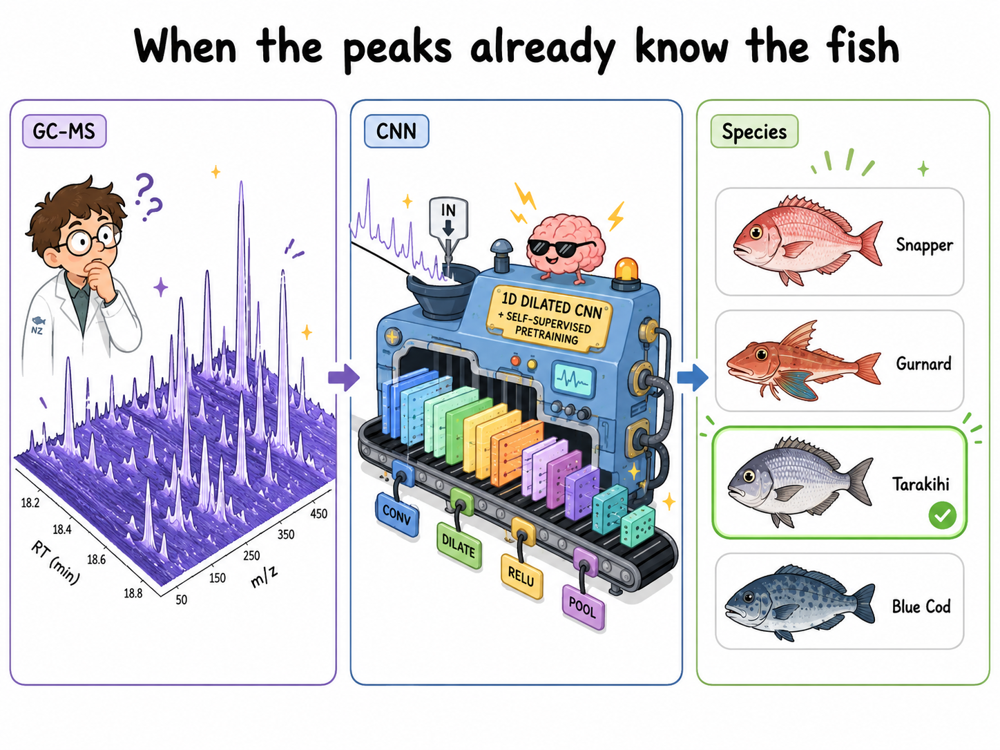

# chroma-dcnn — NZ Fish Species Identification by GC-MS

[](https://www.python.org/downloads/)
[](https://pytorch.org/)
[](https://scikit-learn.org/)
[](LICENSE)



**Project page with interactive results: [woodrock.github.io/chroma-dcnn](https://woodrock.github.io/chroma-dcnn/)**

Species identification of four commercially important New Zealand fish (Snapper, Gurnard, Tarakihi, Blue Cod) from GC-MS lipid profiles using a 1D dilated CNN with self-supervised pretraining.

---

## Dataset

103 GC-MS samples from six biological individuals across four species and six body parts (frame, gonad, head, liver, rest-of-guts, skin).

| Label | Species | n |
|---|---|---|
| 0 | SNA — Snapper (*Pagrus auratus*) | 15 |
| 1 | GUR — Gurnard (*Chelidonichthys kumu*) | 14 |
| 2 | TAR — Tarakihi (*Nemadactylus macropterus*) | 17 |
| 3 | BCO — Blue Cod (*Parapercis colias*) | 57 |

Raw data: 2D GC-MS chromatograms (4800 RT scans × 344 m/z channels, 50–543 Da).  
Preprocessing: uniform 200-bin RT resampling, sqrt + L2 normalisation per bin.

Preprocessed arrays and chromatograms are committed to this repo — no re-processing needed to run training.

---

## Model

**ChromatogramCNN** — a 1D dilated CNN operating on the RT axis of the 2D chromatogram.

```
[B, 200, 1000]                    per-sample 2D chromatogram
    ↓  per-bin spectral embedding
[B, 200, 128]                     RT sequence of spectral features
    ↓  three dilated ResBlocks (kernel=7, dilation=1/2/4)
[B, 128, 200]                     temporal feature map
    ↓  global max-pool ∥ soft attention-pool
[B, 256]                          dual-pooled representation
    ↓  linear head
[B, 4]                            class logits
```

Two conditions are evaluated:

| Condition | Per-bin encoder | Pretrained? |
|---|---|---|
| `from_scratch` | `Linear(1000 → 128)` | No |
| `chroma_pretrain` | `Linear(1000 → 128)` | Yes — next-frame prediction on synthetic GC-MS (MoNA/MassBank) |

All reported fish oil hyperparameters (fine-tuning and baselines) are encoded in [`configs/finetune.yaml`](configs/finetune.yaml); pretraining settings are in [`configs/pretrain.yaml`](configs/pretrain.yaml).

---

## Repository Structure

```
chroma-dcnn/
├── configs/
│   ├── pretrain.yaml                  # ChromaCNN next-frame pretraining
│   ├── finetune.yaml                  # Fish oil: ChromatogramCNN fine-tuning + baselines
│   ├── finetune_rice.yaml             # MTBLS288 rice
│   ├── finetune_wheat.yaml            # MTBLS1187 wheat
│   └── finetune_urine.yaml            # Config for MTBLS71 urine (supplementary)
├── data/
│   └── fish_oil/
│       ├── X.npy                      # [103, 1000] sum spectra
│       ├── y.npy                      # [103] labels
│       ├── groups.txt                 # biological group per sample
│       ├── sample_ids.txt             # sample name per row
│       └── chroma/                    # [103 × 200 × 1000] RT-binned chromatograms
├── figs/
│   ├── generate_gcms_3d.py            # 3D GC-MS chromatogram figure for paper
│   └── ...
├── results/fish_oil/                  # committed results — the paper's source of truth
├── scripts/
│   ├── 01_download_pretrain_data.py   # download MoNA + MassBank
│   ├── 02_preprocess_pretrain_data.py # build data/pretraining/spectra.h5
│   ├── 03_pretrain_chroma.py          # pretrain ChromaCNN on synthetic GC-MS
│   ├── 04_finetune_evaluate.py        # full CV evaluation (CNN conditions)
│   ├── 05_run_baselines.py            # PLS-DA, RF, SVM, MLP baselines
│   ├── 06_smoke_test.py               # single seed × fold sanity check
│   ├── 09_ablation_1d_vs_2d.py        # RT-collapse ablation (2D vs 1D-m/z input)
│   ├── 11_saliency.py                 # gradient saliency figures (figs/saliency-*.png)
│   ├── 12_results_table.py            # main results table + significance tests
│   ├── preprocess_fish_oil.py         # raw CSV → X.npy, y.npy (if raw data available)
│   ├── preprocess_fish_oil_chroma.py  # raw CSV → chroma/*.npz (if raw data available)
│   ├── mtbls71_download_preprocess.py # MTBLS71: download CDFs + build chromatograms
│   ├── mtbls71_finetune_evaluate.py   # MTBLS71: CNN evaluation
│   ├── mtbls71_run_baselines.py       # MTBLS71: PLS-DA, RF, SVM, MLP baselines
│   ├── mtbls288_preprocess.py         # MTBLS288: download CDFs + build chromatograms
│   ├── mtbls288_finetune_evaluate.py  # MTBLS288: CNN evaluation
│   └── mtbls288_run_baselines.py      # MTBLS288: PLS-DA, RF, SVM, MLP baselines
└── src/chroma_dcnn/
    ├── data/                          # datasets, download, preprocessing
    ├── models/                        # ChromatogramCNN, ChromaNextFramePredictor
    ├── training/                      # pretraining and fine-tuning loops
    ├── evaluation/                    # baselines, stats
    └── downstream/                    # fish_oil, urine, rice data loaders
```

---

## Installation

```bash
git clone https://github.com/woodRock/chroma-dcnn.git
cd chroma-dcnn
python -m venv .venv && source .venv/bin/activate
pip install -e ".[dev]"
```

---

## Running the Experiments

The preprocessed fish oil data is committed — clone the repo and start from step 3.

### Step 1 — Download pretraining spectra (if needed)

```bash
python scripts/01_download_pretrain_data.py
```

Outputs `data/pretraining/raw/combined_ei_spectra.json` from MoNA + MassBank EU.

### Step 2 — Build HDF5 dataset (if needed)

```bash
python scripts/02_preprocess_pretrain_data.py
```

Outputs `data/pretraining/spectra.h5` (~9,500 EI-MS spectra, sqrt + L2 normalised).

### Step 3 — Pretrain ChromaCNN (next-frame prediction)

Uses synthetic GC-MS chromatograms generated on-the-fly from `spectra.h5` — no fish oil data used, so there is no information leakage into fine-tuning CV folds.

```bash
python scripts/03_pretrain_chroma.py
```

Checkpoint saved to `checkpoints/chroma_pretrain/best.pt`.

The convolutions use strictly left-only (causal) padding, but BatchNorm computes its statistics
over the full RT sequence in training mode, so the pretraining objective is approximately rather
than strictly autoregressive.

### Step 4 — Full CV evaluation (ChromatogramCNN)

10 seeds × 5-fold stratified CV (~10 min on GPU).  Within each outer fold, a stratified
`val_fraction` (default 0.2) of the training samples is held out for checkpoint selection
and early stopping; the outer test fold is scored once, after training.

```bash
python scripts/04_finetune_evaluate.py
```

Results saved to `results/fish_oil/chroma_results.json`.

### Step 5 — Classical baselines

```bash
python scripts/05_run_baselines.py
```

Evaluates PLS-DA, RF, SVM, MLP on three feature representations:
- `sum` — per-m/z sum spectrum
- `max_proj` — per-m/z maximum across RT (peak heights)
- `chroma_pca` — full 2D chromatogram, StandardScaler + 50 PCs.  PCA is fit on the outer
  training fold only, and refit within every inner CV split used for hyperparameter selection.

PLS-DA selects 1–15 latent variables by inner 5-fold CV; SVM tunes C and γ by inner 3-fold CV.

Results saved to `results/fish_oil/baseline_gcms_{representation}_results.json`.

### Step 6 — Results table

```bash
python scripts/12_results_table.py
```

Ranks all 14 conditions and tests the best against each other (Mann-Whitney U,
Bonferroni over 13 comparisons, rank-biserial |r|).  Writes
`results/fish_oil/main_table.{csv,md}`.

### Step 7 — RT-collapse ablation

```bash
python scripts/09_ablation_1d_vs_2d.py
```

Runs `from_scratch` ChromaDCNN through the same `ChromaFinetuner` code path as step 4, on
(a) the 2D chromatogram and (b) a degenerate input where each sample's sum spectrum is tiled
across all 200 RT bins.  Writes `results/fish_oil/ablation_1d_vs_2d_*`.

### Step 8 — Saliency figures

```bash
python scripts/11_saliency.py
```

Seed 0 × 5 folds of `chroma_pretrain`, trained exactly as in step 4; gradient saliency
|∂logit_c/∂X| is computed on each fold's held-out test samples only.  Writes
`figs/saliency-{heatmaps,1d,3d}.png` and `results/fish_oil/saliency_mean.npz`.
(`notebooks/04_saliency.ipynb` is the earlier exploratory version and does not follow this protocol.)

### Step 9 — Project website

```bash
python scripts/13_build_site_data.py
```

Exports the results above to `docs/data.js` for the GitHub Pages site in `docs/`
(served from the `main` branch, `/docs` folder).  Preview locally with
`python -m http.server -d docs` and open http://localhost:8000.

### Step 10 — Smoke test (optional)

Quick single-seed × single-fold check before committing to the full run:

```bash
python scripts/06_smoke_test.py --seed 0 --fold 0 --epochs 100
```

### Tests

```bash
pip install -e ".[test]"
pytest --cov            # unit + integration tests, coverage report
ruff check .            # lint
```

CI (`.github/workflows/ci.yml`) runs lint, the test suite on Python 3.10–3.12, and a
package build on every push and pull request.

---

## Applying to Other GC-MS Datasets

The preprocessing scripts serve as worked examples for integrating any GC-MS dataset
stored in ANDI/netCDF (`.cdf`) or CSV format.  The key steps are the same regardless
of organism or instrument: reconstruct a dense RT×m/z matrix from the raw file, bin the
RT axis to 200 uniform windows, sqrt+L2 normalise each bin, and save as a `[200, 1000]`
compressed `.npz`.  Adapt one of the scripts below as a starting point.

### MTBLS71 — Human Urine (MetaboLights)

160 GC-MS urine samples from 40 donors (20F / 20M), two treatments, two injections each.  
Demonstrates: FTP download, donor-grouped CV to prevent replicate leakage, binary classification.

```bash
python scripts/mtbls71_download_preprocess.py --workers 8   # ~3 GB download
python scripts/mtbls71_finetune_evaluate.py
python scripts/mtbls71_run_baselines.py --grouped-cv
```

### MTBLS288 — Rice Grain Development (MetaboLights)

80 GC-MS samples: 4 cultivars × 5 developmental stages × 4 biological replicates.  
Demonstrates: metadata-driven label parsing (ISA-Tab assay tables), grouped CV by
biological replicate, handling a within-class nuisance variable (developmental stage).

```bash
python scripts/mtbls288_preprocess.py --workers 8           # ~5 GB download
python scripts/mtbls288_finetune_evaluate.py
python scripts/mtbls288_run_baselines.py
```

### MTBLS1187 — Wheat Bread Old vs. Modern (MetaboLights)

120 GC-QTOF flour metabolite profiles: 40 winter wheat cultivars × 3 German growing locations.  
Binary classification: old varieties (released 1962–1999) vs. modern (2005–2014).  
Demonstrates: ISA-Tab metadata parsing, cultivar-grouped CV to prevent location leakage.

```bash
python scripts/mtbls1187_preprocess.py --workers 8          # ~4.5 GB download
python scripts/mtbls1187_finetune_evaluate.py
python scripts/mtbls1187_run_baselines.py
```

> **Note:** On urine and rice, classical sum-spectrum baselines outperform the 2D CNN,
> consistent with conditions where the RT dimension is dominated by a nuisance variable
> rather than the classification target.  The CNN advantage shown on the fish oil dataset
> requires the chromatographic structure to be informative for the target class — see the
> paper for a discussion of when each approach is preferred.

---

## Results

All numbers below are reproduced by the scripts above and stored in
[`results/fish_oil/`](results/fish_oil/), which is the source of truth.

10 seeds × 5-fold stratified CV (n = 50 per method).  ChromaDCNN uses a nested hold-out: within
each outer fold, 20% of the training samples form a validation split that drives early stopping
and checkpoint selection; the test fold is scored once, after training.  Comparisons are
two-sided Mann-Whitney U against the best method, Bonferroni-corrected over 13 comparisons
(α = 0.05); |r| is the rank-biserial effect size.

### Main comparison (`results/fish_oil/main_table.md`)

| Rank | Method | Representation | Balanced acc. | \|r\| vs best | p (Bonferroni) | Sig. |
|:----:|--------|----------------|:-------------:|:-------------:|:--------------:|:----:|
| 1 | **ChromaDCNN (chroma_pretrain)** | 2D chromatogram | **0.854 ± 0.101** | — | — | — |
| 2 | SVM (RBF) | chroma-PCA | 0.698 ± 0.102 | 0.711 | 1.13e-08 | Yes |
| 3 | Random Forest | sum spectrum | 0.696 ± 0.113 | 0.684 | 4.91e-08 | Yes |
| 4 | PLS-DA | chroma-PCA | 0.692 ± 0.096 | 0.734 | 3.22e-09 | Yes |
| 5 | ChromaDCNN (from_scratch) | 2D chromatogram | 0.603 ± 0.176 | 0.799 | 7.43e-11 | Yes |
| 6 | SVM (RBF) | max-projection | 0.532 ± 0.120 | 0.960 | 1.68e-15 | Yes |
| 7 | Random Forest | chroma-PCA | 0.530 ± 0.115 | 0.970 | 8.19e-16 | Yes |
| 8 | SVM (RBF) | sum spectrum | 0.493 ± 0.083 | 0.992 | 1.53e-16 | Yes |
| 9 | PLS-DA | max-projection | 0.469 ± 0.107 | 0.983 | 3.15e-16 | Yes |
| 10 | PLS-DA | sum spectrum | 0.429 ± 0.114 | 0.992 | 1.64e-16 | Yes |
| 11 | MLP | max-projection | 0.395 ± 0.123 | 0.996 | 1.21e-16 | Yes |
| 12 | Random Forest | max-projection | 0.382 ± 0.094 | 0.998 | 1.02e-16 | Yes |
| 13 | MLP | chroma-PCA | 0.377 ± 0.159 | 0.970 | 8.21e-16 | Yes |
| 14 | MLP | sum spectrum | 0.369 ± 0.125 | 0.994 | 1.39e-16 | Yes |

- Pretrained ChromaDCNN significantly outperforms all 13 other conditions: +15.6 pp over the
  best classical baseline (SVM on chroma-PCA) and +25.1 pp over training from scratch.
- From scratch, ChromaDCNN is statistically indistinguishable from the top three classical
  baselines (Bonferroni p ≈ 0.15–0.44), so pretraining is what makes it win.
- For PLS-DA and SVM, chroma-PCA features (2D chromatogram) beat sum-spectrum features
  (+26.3 pp and +20.5 pp).

### RT-collapse ablation (`results/fish_oil/ablation_1d_vs_2d_summary.md`)

Both conditions are `from_scratch` and run through the same training code as the main table;
the 2D condition reproduces the main table's `from_scratch` fold scores exactly.

| Condition | Balanced acc. | Δ vs 2D | p (Mann-Whitney U) | \|r\| |
|---|:-:|:-:|:-:|:-:|
| 2D chromatogram | 0.603 ± 0.176 | — | — | — |
| 1D-m/z (sum spectrum tiled over RT) | 0.406 ± 0.126 | −0.197 | 1.01e-07 | 0.617 |

Removing RT structure costs about 20 pp, leaving ChromaDCNN level with the classical
sum-spectrum baselines (e.g. PLS-DA on sum spectrum, 0.429).

### Saliency (`figs/saliency-*.png`)

Gradient saliency for `chroma_pretrain` on held-out samples (seed 0, 5 folds, mean fold
balanced accuracy 0.887).  The m/z saliency profile is near-identical across species
(pairwise r ≥ 0.99); RT profiles are more variable (pairwise r 0.74–0.88).  Every species
concentrates saliency in the 40–44 min band (30–55% of RT saliency; Tarakihi most, Gurnard
least), with a secondary band at 18–22 min (12–14%).  Gurnard also has saliency at 33–37 min (13%).
The 24–28 min region carries little saliency (3–6%) for any species.

---

## Citation

```bibtex
@misc{wood2026chromadcnn,
  author = {Wood, Jesse},
  title  = {chroma-dcnn: GC-MS Fish Species Identification with Self-Supervised Pretraining},
  year   = {2026},
  url    = {https://github.com/woodRock/chroma-dcnn}
}
```

**Pretraining data:**
- MoNA — MassBank of North America: [mona.fiehnlab.ucdavis.edu](https://mona.fiehnlab.ucdavis.edu)
- MassBank EU: [massbank.eu](https://massbank.eu)
